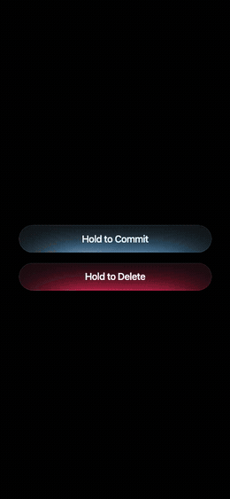
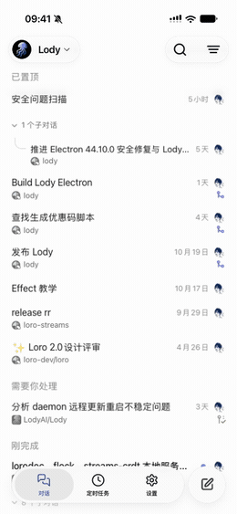
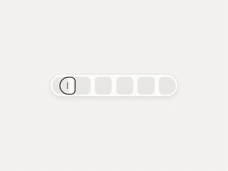
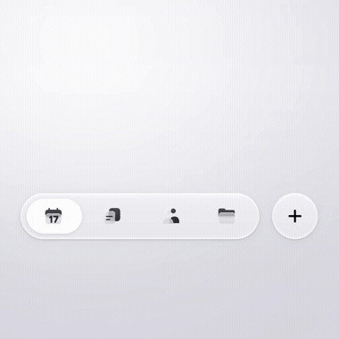
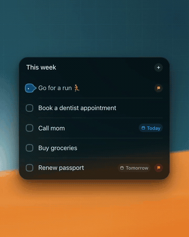
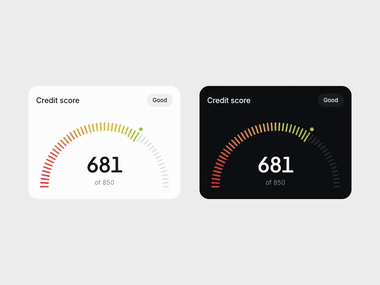
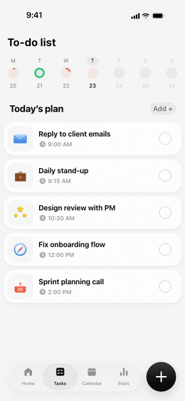
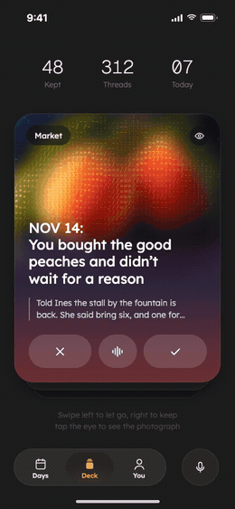
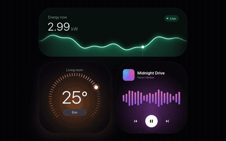
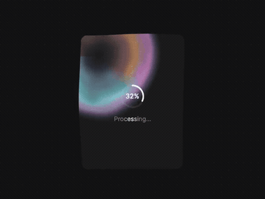

# Now In Code

**The UI you saved. Now in code.**

[Now In Code](https://nowincode.com/?utm_source=github) rebuilds the UI and motion designs people save on X, RedNote and Pinterest from scratch as working code in two matched versions: **React Native (Expo)** and **plain web (HTML, CSS, JS)** — built from one shared timing core so the motion matches on a phone and in a browser.

This repository holds all **10 MIT-licensed free pieces** with full source and previews. The full library has **204 pieces** (new ones every Monday): [browse with live previews](https://nowincode.com/library?utm_source=github).

## Preview the 10 free pieces

<table>
<tr>
<td width="50%" valign="top" align="center">
  <a href="https://nowincode.com/library/hold-to-confirm-glow-fill-button?utm_source=github"></a><br />
  <strong><a href="https://nowincode.com/library/hold-to-confirm-glow-fill-button?utm_source=github">Hold-to-Confirm Glow Fill Button</a></strong><br />
  <sub>A pill button that fills with light while held, then bursts into sparks</sub><br />
  <a href="pieces/hold-to-confirm-glow-fill-button">Source</a> · <a href="https://nowincode.com/library/hold-to-confirm-glow-fill-button?utm_source=github">Live preview</a> · Inspired by <a href="https://x.com/a_cucos/status/2107894726628127140">@a_cucos</a>
</td>
<td width="50%" valign="top" align="center">
  <a href="https://nowincode.com/library/sticky-section-headers-with-progressive-blur?utm_source=github"></a><br />
  <strong><a href="https://nowincode.com/library/sticky-section-headers-with-progressive-blur?utm_source=github">Sticky Section Headers with Progressive Blur</a></strong><br />
  <sub>Grouped list with sticky headers and a progressive blur over scrolled rows</sub><br />
  <a href="pieces/sticky-section-headers-with-progressive-blur">Source</a> · <a href="https://nowincode.com/library/sticky-section-headers-with-progressive-blur?utm_source=github">Live preview</a> · Inspired by <a href="https://x.com/leon7hao/status/2120047269340946932">@leon7hao</a>
</td>
</tr>
<tr>
<td width="50%" valign="top" align="center">
  <a href="https://nowincode.com/library/morphing-verification-code-input?utm_source=github"></a><br />
  <strong><a href="https://nowincode.com/library/morphing-verification-code-input?utm_source=github">Morphing Verification Code Input</a></strong><br />
  <sub>A pill opens into six code boxes, shakes on error and turns green on success</sub><br />
  <a href="pieces/morphing-verification-code-input">Source</a> · <a href="https://nowincode.com/library/morphing-verification-code-input?utm_source=github">Live preview</a> · Inspired by <a href="https://x.com/sucodeee/status/2107420636113191248">@sucodeee</a>
</td>
<td width="50%" valign="top" align="center">
  <a href="https://nowincode.com/library/morphing-toolbar-plus-quick-menu?utm_source=github"></a><br />
  <strong><a href="https://nowincode.com/library/morphing-toolbar-plus-quick-menu?utm_source=github">Morphing Toolbar Plus Quick Menu</a></strong><br />
  <sub>A light toolbar morphs into a 3x2 menu, plus a glass lens tab switch</sub><br />
  <a href="pieces/morphing-toolbar-plus-quick-menu">Source</a> · <a href="https://nowincode.com/library/morphing-toolbar-plus-quick-menu?utm_source=github">Live preview</a> · Inspired by <a href="https://x.com/uiinspoo/status/2113591752158482613">@uiinspoo</a>
</td>
</tr>
<tr>
<td width="50%" valign="top" align="center">
  <a href="https://nowincode.com/library/checkbox-spike-strikethrough-todo?utm_source=github"></a><br />
  <strong><a href="https://nowincode.com/library/checkbox-spike-strikethrough-todo?utm_source=github">Checkbox Spike Strikethrough Todo</a></strong><br />
  <sub>A checkbox grows a speech-bubble spike that drags a strikethrough over text</sub><br />
  <a href="pieces/checkbox-spike-strikethrough-todo">Source</a> · <a href="https://nowincode.com/library/checkbox-spike-strikethrough-todo?utm_source=github">Live preview</a> · Inspired by <a href="https://x.com/barret_jessy/status/2114756442804949307">@barret_jessy</a>
</td>
<td width="50%" valign="top" align="center">
  <a href="https://nowincode.com/library/draggable-tick-arc-score-gauge?utm_source=github"></a><br />
  <strong><a href="https://nowincode.com/library/draggable-tick-arc-score-gauge?utm_source=github">Draggable Tick Arc Score Gauge</a></strong><br />
  <sub>A 51-tick half-circle gauge you drag to set a score from 300 to 850</sub><br />
  <a href="pieces/draggable-tick-arc-score-gauge">Source</a> · <a href="https://nowincode.com/library/draggable-tick-arc-score-gauge?utm_source=github">Live preview</a> · Inspired by <a href="https://x.com/cabralorenzo/status/2123723992452190252">@cabralorenzo</a>
</td>
</tr>
<tr>
<td width="50%" valign="top" align="center">
  <a href="https://nowincode.com/library/check-off-task-reorder-list?utm_source=github"></a><br />
  <strong><a href="https://nowincode.com/library/check-off-task-reorder-list?utm_source=github">Check-Off Task Reorder List</a></strong><br />
  <sub>Check a task and its card sinks to the bottom while the rest slide up</sub><br />
  <a href="pieces/check-off-task-reorder-list">Source</a> · <a href="https://nowincode.com/library/check-off-task-reorder-list?utm_source=github">Live preview</a> · Inspired by <a href="https://x.com/marten_maxxx/status/2113246307557200184">@marten_maxxx</a>
</td>
<td width="50%" valign="top" align="center">
  <a href="https://nowincode.com/library/thrown-card-stack-with-sheets-and-undo?utm_source=github"></a><br />
  <strong><a href="https://nowincode.com/library/thrown-card-stack-with-sheets-and-undo?utm_source=github">Thrown Card Stack with Sheets and Undo</a></strong><br />
  <sub>Eight linked interactions: throw cards, undo, reveal a photo, open sheets</sub><br />
  <a href="pieces/thrown-card-stack-with-sheets-and-undo">Source</a> · <a href="https://nowincode.com/library/thrown-card-stack-with-sheets-and-undo?utm_source=github">Live preview</a> · Inspired by <a href="https://x.com/tobiadonadon_/status/2124633199443595342">@tobiadonadon_</a>
</td>
</tr>
<tr>
<td width="50%" valign="top" align="center">
  <a href="https://nowincode.com/library/glowing-live-home-widgets?utm_source=github"></a><br />
  <strong><a href="https://nowincode.com/library/glowing-live-home-widgets?utm_source=github">Glowing Live Home Widgets</a></strong><br />
  <sub>Three dark widgets: a scrolling energy line, a spring thermostat, bouncing bars</sub><br />
  <a href="pieces/glowing-live-home-widgets">Source</a> · <a href="https://nowincode.com/library/glowing-live-home-widgets?utm_source=github">Live preview</a> · Inspired by <a href="https://x.com/seanaiux/status/2114829924133728625">@seanaiux</a>
</td>
<td width="50%" valign="top" align="center">
  <a href="https://nowincode.com/library/ai-image-generate-and-dust-disintegrate?utm_source=github"></a><br />
  <strong><a href="https://nowincode.com/library/ai-image-generate-and-dust-disintegrate?utm_source=github">AI Image Generate and Dust Disintegrate</a></strong><br />
  <sub>An image card goes from progress ring to focused photo, then crumbles to dust</sub><br />
  <a href="pieces/ai-image-generate-and-dust-disintegrate">Source</a> · <a href="https://nowincode.com/library/ai-image-generate-and-dust-disintegrate?utm_source=github">Live preview</a> · Inspired by <a href="https://x.com/benchodev/status/2122766724835823644">@benchodev</a>
</td>
</tr>
</table>

## Quick install (CLI)

Install any piece straight into your project — no runtime library dependency, you own the source files:

```sh
npx nowincode login
npx nowincode add hold-to-confirm-glow-fill-button
```

- Writes the React Native (Expo, TypeScript) files to `components/<slug>/` and prints the exact `npx expo install` command for any extra dependencies.
- Pass `--web` to install the self-contained browser version instead.
- Or copy any folder directly from `pieces/<slug>/` (no login needed for these 10 MIT pieces).

## Use with a coding agent (Agent Skill)

Install the Now In Code skill for Claude Code, Cursor, Codex, Windsurf and other coding agents:

```sh
npx skills add nowincode/nowincode
```

It teaches your agent how to search the catalog via [`llms.txt`](https://nowincode.com/llms.txt), inspect piece specs via `/library/<slug>.md`, and install pieces with `npx nowincode add <slug>`.

## All 10 free pieces

| Piece | Type | Code | Inspired by | Extra dependencies |
|---|---|---|---|---|
| [Hold-to-Confirm Glow Fill Button](https://nowincode.com/library/hold-to-confirm-glow-fill-button?utm_source=github) | Components | [source](pieces/hold-to-confirm-glow-fill-button) | [@a_cucos](https://x.com/a_cucos/status/2107894726628127140) | `@shopify/react-native-skia` `expo-haptics` `react-native-svg` |
| [Sticky Section Headers with Progressive Blur](https://nowincode.com/library/sticky-section-headers-with-progressive-blur?utm_source=github) | Components | [source](pieces/sticky-section-headers-with-progressive-blur) | [@leon7hao](https://x.com/leon7hao/status/2120047269340946932) | `@react-native-masked-view/masked-view` `expo-blur` `expo-linear-gradient` `react-native-svg` |
| [Morphing Verification Code Input](https://nowincode.com/library/morphing-verification-code-input?utm_source=github) | Components | [source](pieces/morphing-verification-code-input) | [@sucodeee](https://x.com/sucodeee/status/2107420636113191248) | `expo-blur` `react-native-svg` |
| [Morphing Toolbar Plus Quick Menu](https://nowincode.com/library/morphing-toolbar-plus-quick-menu?utm_source=github) | Components | [source](pieces/morphing-toolbar-plus-quick-menu) | [@uiinspoo](https://x.com/uiinspoo/status/2113591752158482613) | `@shopify/react-native-skia` |
| [Checkbox Spike Strikethrough Todo](https://nowincode.com/library/checkbox-spike-strikethrough-todo?utm_source=github) | Components | [source](pieces/checkbox-spike-strikethrough-todo) | [@barret_jessy](https://x.com/barret_jessy/status/2114756442804949307) | `expo-blur` `react-native-svg` |
| [Draggable Tick Arc Score Gauge](https://nowincode.com/library/draggable-tick-arc-score-gauge?utm_source=github) | Components | [source](pieces/draggable-tick-arc-score-gauge) | [@cabralorenzo](https://x.com/cabralorenzo/status/2123723992452190252) | `react-native-svg` |
| [Check-Off Task Reorder List](https://nowincode.com/library/check-off-task-reorder-list?utm_source=github) | Components | [source](pieces/check-off-task-reorder-list) | [@marten_maxxx](https://x.com/marten_maxxx/status/2113246307557200184) | `react-native-svg` |
| [Thrown Card Stack with Sheets and Undo](https://nowincode.com/library/thrown-card-stack-with-sheets-and-undo?utm_source=github) | Components | [source](pieces/thrown-card-stack-with-sheets-and-undo) | [@tobiadonadon_](https://x.com/tobiadonadon_/status/2124633199443595342) | `@shopify/react-native-skia` `expo-linear-gradient` `react-native-gesture-handler` `react-native-reanimated` `react-native-svg` |
| [Glowing Live Home Widgets](https://nowincode.com/library/glowing-live-home-widgets?utm_source=github) | Components | [source](pieces/glowing-live-home-widgets) | [@seanaiux](https://x.com/seanaiux/status/2114829924133728625) | `react-native-svg` |
| [AI Image Generate and Dust Disintegrate](https://nowincode.com/library/ai-image-generate-and-dust-disintegrate?utm_source=github) | Interactions | [source](pieces/ai-image-generate-and-dust-disintegrate) | [@benchodev](https://x.com/benchodev/status/2122766724835823644) | `@shopify/react-native-skia` `react-native-reanimated` |

Each folder contains `rn/` (React Native, Expo SDK 54), `web/` (self-contained HTML/CSS/JS) and a README.

## Full library (204 pieces)

194 more pieces across screens & flows, onboarding & paywalls, components, interactions, data viz and shader effects are available with a [Now In Code plan](https://nowincode.com/pricing?utm_source=github) (Quarterly $45, Yearly $129, or Lifetime $249 launch price). See how Now In Code compares with other React Native motion libraries on [nowincode.com/compare](https://nowincode.com/compare?utm_source=github).

## Credits and removal

Every piece is inspired by a design shared publicly by its author, credited above and on each piece page. If one of them is yours and you want the credit updated or the piece removed, use the [removal form](https://nowincode.com/removal?utm_source=github) or email support@nowincode.com. Removal requests are handled within 3 business days.

## License

MIT for everything in this repository. See [LICENSE](LICENSE). Bundled fonts keep their own open licenses (SIL OFL).
